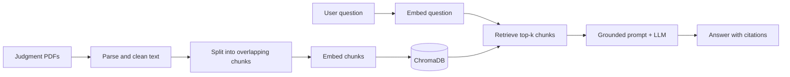

# Legal Case Research Assistant (RAG)

A question-answering app over Indian Supreme Court judgments. You ask a question in plain English, and the app finds the most relevant passages in the judgments and writes an answer **only from those passages**, with citations to the file and page it used.

> This is a research tool built as a learning project. It is **not legal advice**.


## Why I built it

Language models can sound confident while making things up, which is a real problem for legal text. This project uses Retrieval-Augmented Generation (RAG) to keep answers grounded in real documents. If the retrieved passages do not contain the answer, the assistant says so instead of guessing.

## How it works



1. **Ingestion (`ingest.py`)**: reads each PDF page by page, cleans the text (page numbers, broken lines, hyphenation), and splits it into 1,000-character chunks with 200 characters of overlap. Every chunk keeps its file name and page number.
2. **Indexing**: chunks are embedded with `BAAI/bge-small-en-v1.5` and stored in a local ChromaDB database.
3. **Retrieval (`app.py`)**: the question is embedded and the 5 most relevant chunks are fetched using MMR search, which avoids near-duplicate results.
4. **Generation**: the chunks go to an LLM with a strict prompt: answer only from the numbered passages, cite them like [1] or [2], and say "I couldn't find this in the provided judgments." when the answer is not there.
5. **Interface**: a Streamlit app shows the answer and the source passages.

## Tech stack

| Part | Tool |
| --- | --- |
| Language | Python |
| Orchestration | LangChain |
| PDF parsing | PyMuPDF |
| Embeddings | sentence-transformers (`BAAI/bge-small-en-v1.5`) |
| Vector database | ChromaDB |
| LLM | `openai/gpt-oss-120b` via the Groq API |
| UI | Streamlit |

## Dataset

Judgments come from the **Indian Supreme Court Judgments** open dataset (2025 English PDFs), licensed CC-BY-4.0:
https://registry.opendata.aws/indian-supreme-court-judgments/

The PDFs are not included in this repository. Please see the dataset page for the exact attribution requirements.

## Project structure

```
legal-rag/
├── app.py              # Streamlit app: retrieval + LLM answer
├── ingest.py           # PDF -> chunks -> embeddings -> ChromaDB
├── search_test.py      # Quick retrieval check without the LLM
├── requirements.txt
├── .env.example        # Template for your API key
└── data/pdfs/          # Your judgment PDFs (not committed)
```

## Run it locally (macOS)

**1. Clone and create an environment**
```bash
git clone <your-repo-url>
cd legal-rag
python3.12 -m venv .venv
source .venv/bin/activate
pip install -r requirements.txt
```

**2. Add your API key**

Create a free key at [console.groq.com](https://console.groq.com), then:
```bash
cp .env.example .env
# open .env and paste your GROQ_API_KEY
```

**3. Add the judgments**

Download some judgment PDFs from the dataset above and put them in `data/pdfs/`.

**4. Build the index**
```bash
python ingest.py 40      # first 40 PDFs; omit the number to index all
```

**5. (Optional) Test retrieval on its own**
```bash
python search_test.py "limitation period for filing a suit"
```

**6. Start the app**
```bash
streamlit run app.py
```

## Evaluation

I test retrieval and answer quality on a hand-written question set where I know the correct source file and page.

| Metric | Result |
| --- | --- |
| Number of test questions | _to be filled_ |
| Retrieval hit rate (correct page in top 5) | _to be filled_ |
| Answers faithful to the sources (manual check) | _to be filled_ |
| Out-of-scope questions correctly refused | _to be filled_ |

## Limitations

- Only a sample of 2025 judgments is indexed, so many legal questions will not be answerable.
- Scanned PDFs without a text layer are skipped.
- Chunks are split per page, so a passage that runs across two pages can be cut in the middle.
- Citations show file names, not full case names.
- The answer is only as good as the retrieved passages, so always check the sources shown under the answer.

## Ideas for next steps

- Hybrid search (BM25 + vector) and a reranker
- Show real case names and dates using the dataset metadata
- Automated evaluation with Ragas
- Deploy on Streamlit Community Cloud or Hugging Face Spaces

## Acknowledgements

- Indian Supreme Court Judgments dataset (AWS Open Data Registry)
- LangChain, ChromaDB, sentence-transformers, Streamlit, Groq